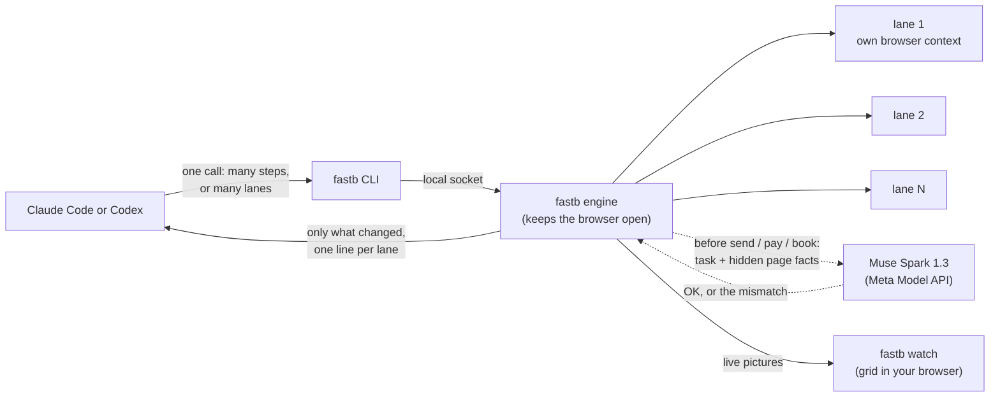

# fastb

A fast browser for AI coding agents. Claude Code and Codex drive real browsers with it: many steps per call, many browsers at once, and a Meta model that checks the result before anything irreversible happens.

Built during the Meta Global AI Developer Hackathon (Oct 26 to Nov 5, 2026).

## Why

Browser agents are slow because they ask the model about every single click. In our baseline (Claude Code with Playwright MCP on 22 tasks of the REAL benchmark), a task took 74 s and 30 model turns. Each turn wrote only about 88 tokens, but each one cost about 2 s, because the model reads the whole conversation again every time. The cost is the number of round trips, not long thinking.

fastb cuts the round trips:

- **Chunks.** The agent sends many steps in one call (`fill`, `click`, `expect`...). fastb runs them at code speed and stops at the first surprise.
- **Changes only.** After a chunk, the agent sees only what changed on the page, not the whole page again.
- **Lanes.** One call drives many isolated browsers at the same time. You can watch them all live.
- **A Meta model checks the work.** Before a send, pay or book click, Muse Spark compares the page with the task. A wrong date or a wrong number of guests stops the click, with the reason.

## How it works



1. The agent writes many steps at once (or one block per lane). It can target elements by visible text, also ones that appear later in the same run.
2. The engine runs them with Playwright at code speed. It waits for the page to stop changing, not for "network idle", and stops at the first surprise.
3. The answer is short: `OK 6/6 steps 0.9s` or `STOP at step 4/6: reason`, then only the lines of the page that changed.
4. Before an irreversible click, the Meta model compares the page with the task (when a person turned the check on).

## Results

From `~/Desktop/fastb-bench` (REAL v1 action tasks, same Chrome, same scoring for every setup). Single runs so far; phase 8 repeats each setup 3 times and this section will show those numbers.

| Setup | Success | Median time per task | Median turns | Cost (22 tasks) |
|---|---|---|---|---|
| Claude Code + Playwright MCP (baseline) | 17/22 | 74 s | 30 | $5.77 |
| Claude Code + fastb | 17/22 | 36 s (2.07x faster) | 10 | $3.44 |

All 22 tasks with lanes (3 prompts, one lane per task): 18/22 passed in 693 s, against 2301 s for the baseline doing them one by one (3.3x faster), with 138 turns instead of 632 and $2.52 instead of $5.77.

Details and caveats: `docs/bench-2026-10-27.md`.

## Install

Needs Node 22 or newer and Google Chrome.

```
git clone https://github.com/pejovicvuk/fastb
cd fastb
npm install
npm run build
npm link        # puts "fastb" on your PATH
```

## Use it

```
fastb open https://example.com      # open a page and print it as short text with refs (@e12)
fastb run <<'EOF'                   # many steps in one call
fill "Email" = test@example.com
click button "Sign up"
expect text "Welcome"
EOF
fastb look                          # the whole page again
fastb stop
```

Several tasks at once, each in its own browser (own cookies and storage):

```
fastb lanes <<'EOF'
lane us
goto https://shop.example/cart
click "Checkout"
lane eu
goto https://shop.example/cart?country=de
click "Checkout"
EOF
fastb watch                         # live grid of all lanes in your browser
```

Use your own Chrome (logged in) with `--cdp http://127.0.0.1:9222`. Run `fastb` with no arguments for all commands.

### For Claude Code and Codex

- Claude Code: copy `skill/fastb` to `.claude/skills/fastb` in your project, or put the text of `skill/AGENTS.md` in your `CLAUDE.md`.
- Codex: put the text of `skill/AGENTS.md` in your `AGENTS.md`.
- Allow the agent to run `fastb` (Claude Code: `Bash(fastb:*)`).

## The Meta model

fastb uses **Muse Spark 1.3** through the Meta Model API for two jobs:

1. **Commit check.** When a run reaches a send / pay / book click and the agent has given the task (`task Book a table for 4 on July 20`), Muse Spark compares the task with the form values and the visible text. A mismatch stops the click: `CHECK before "Complete reservation" (not clicked): date is "Jul 19", task wants "July 20, 2024"`. A check takes about 1.5 to 2 s; lanes check at the same time.
2. **Lane report.** `fastb lanes report` groups the results of many lanes by cause in a few lines, for example: `stopped (2), date is not July 20 (Jul 19, Jul 21)`.

Both are **off by default**, because they send page facts to the Meta API. A person turns them on by writing `on` to `~/.fastb/remote-check` (fastb has no command for it, so an agent limited to running fastb cannot). The API key goes in `~/.fastb/secrets.env` as `META_API_KEY=...`.

## Safety and privacy

- A click on a send / delete / pay / order / book control stops the run unless the run has an `allow` line.
- Before anything goes to the Meta API, fastb hides private values: fields labelled card, CVV, account, IBAN, password and similar; card-like and other long numbers, emails and token-like strings the task does not name; URL queries; values after words like CVV, PIN or password; and values typed into secret fields earlier. The lane report sends only fixed result codes, never page text.
- The live grid listens on 127.0.0.1 only, under a secret path, and refuses other Host and Origin headers. Typed values are hidden in its step text.

**Known limits.** Hiding works by pattern: with the check on, private values without such a shape (names, addresses) can still be sent. A few milliseconds remain between the last page read and the click, and the real request is not held for checking. Long numbers are always hidden, so the check cannot compare phone or account numbers.

## How it was built

Claude Code (orchestrator) and Codex (workers in their own git worktrees, and adversarial reviews at the end of each phase) wrote the code during the event. Plan, decisions and benchmark notes are in `docs/`.

## License

MIT
